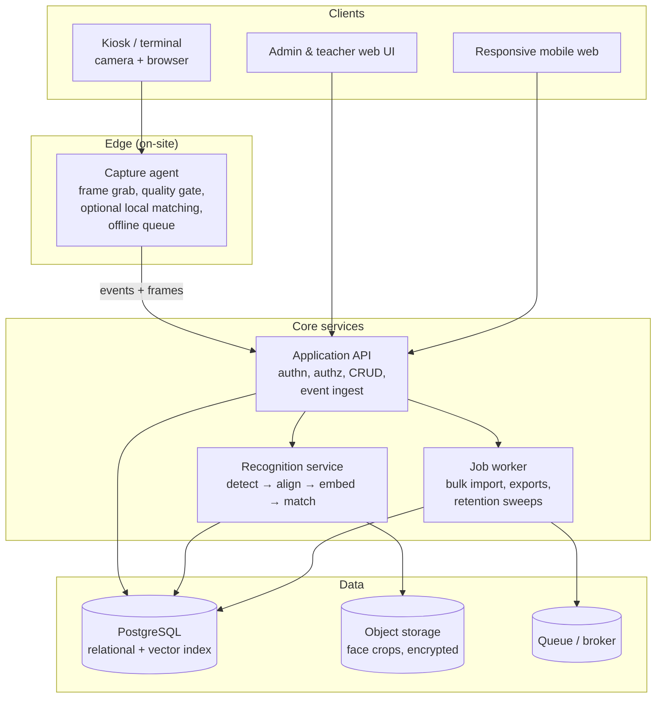

# Architecture

**Status:** draft / proposal
**Scope:** describes the intended system. No component below exists in code yet.
**Last updated:** 2026-11-06

Anything marked **🔴 OPEN** is not decided. Do not build against it without first
recording a decision in [`decisions/`](decisions/).

---

## 1. Goals and non-goals

### Goals

1. Enrol a person once, with one or more face samples and a consent record.
2. Record attendance events automatically, with a confidence score and an audit trail.
3. Support an operational fallback when recognition fails (manual check-in, QR/NFC card).
4. Keep biometric data auditable, revocable and deletable on request.
5. Work offline-ish at edge locations (turnstile, classroom door) without losing events.

### Non-goals (for v1)

- Continuous surveillance / live tracking of people across the campus.
- Emotional state, age, gender or ethnicity inference.
- Proctoring or any use that makes an automated academic-integrity decision.
- Mobile-native apps (a responsive web UI is assumed).

The non-goals matter: a face-ID system slides into surveillance by default if the
architecture does not explicitly rule it out.

---

## 2. Actors

| Actor | Needs |
| --- | --- |
| **Student** | Enrol their face, see their own attendance, request deletion |
| **Teacher / Instructor** | Start a session, see who was detected, correct mistakes |
| **Registrar / Admin** | Manage people, groups, schedules, exports |
| **Security operator** | Monitor turnstiles, resolve unrecognised faces |
| **System administrator** | Manage devices, model versions, thresholds, retention |
| **Auditor** | Read-only access to access logs and consent records |

---

## 3. Proposed high-level architecture



The **capture agent** is the important boundary. It is the only component that talks to a
camera, and it is deliberately dumb: it grabs frames, rejects bad ones, and ships them.
Putting model inference at the edge is **🔴 OPEN** (see §7).

---

## 4. Recognition pipeline

```
frame ──▶ detect ──▶ quality gate ──▶ align ──▶ embed ──▶ match ──▶ decide ──▶ event
           │            │                         │          │         │
        multiple     blur/pose/            512-D or     cosine    threshold
        faces?       exposure?            128-D vec     similarity  + margin
        reject      reject iff            normalize    search     rule
                    below bar                         (index)
```

### 4.1 Detection
Locate face bounding boxes. If a frame contains many faces, the frame is either a group
photo (fine for enrolment review) or a crowd (must not silently pick one face).

### 4.2 Quality gate
The single biggest accuracy lever, and the cheapest. Reject on: blur (variance of
Laplacian), yaw/pitch beyond a limit, occlusion, exposure, and too-small face crops.
Rejecting bad frames client-side avoids uploading and embedding junk.

### 4.3 Alignment + embedding
Landmark-based alignment, then a trained embedding model. Stores **the embedding**, not
the raw image, as the primary matching artefact.

> **Model choice is 🔴 OPEN.** Practical candidates: InsightFace (ArcFace-family, strong
> accuracy, Python-native), dlib/`face_recognition` (simple, older, weaker on pose), or a
> hosted API (fastest to ship, worst for data residency and per-call cost).
> Record it in `decisions/0002-embedding-model.md`.

### 4.4 Matching
Cosine similarity over normalised vectors, top-k via an approximate-nearest-neighbour
index (pgvector `ivfflat`/`hnsw`, or FAISS if the population outgrows Postgres).

**Decision rule.** Not "highest score wins". Two parameters:

- `T_accept` — below this, no match at all → `unknown`.
- `margin` — the gap between the best and the second-best candidate. A high score with a
  tiny margin is a *collision*, not a match, and is the classic 1:N failure mode.

```
if best < T_accept            -> no_match
elif best - second < margin   -> ambiguous  (queue for human review)
else                          -> match
```

`T_accept` and `margin` are **🔴 OPEN** and must be derived from a labelled validation set,
per deployment, not guessed.

### 4.5 Liveness / anti-spoofing
A photo held to a camera defeats any pure-embedding system. Options: passive texture
analysis, depth from a supported camera, active challenge (blink/turn), or accepting the
risk because a human supervisor is present at the terminal.

> **🔴 OPEN.** For a supervised classroom this may be acceptable to defer; for an unmanned
> turnstile it is mandatory. Recorded in `decisions/0003-liveness.md`.

---

## 5. Data layer

PostgreSQL is the working assumption (**🔴 OPEN** — see §7), because it keeps relational
data and embeddings in one transactional store and avoids a second database until scale
justifies it.

- Face embeddings: `vector` column + HNSW index (`pgvector`).
- Raw face images: object storage, encrypted at rest, referenced by opaque ID, with a
  retention clock. Never in the relational DB.
- Event log: append-only, partitioned by month.

Full entity list: [`data-model.md`](data-model.md).

---

## 6. Cross-cutting concerns

### 6.1 Biometric data is special-category data
Face templates are biometric identifiers. Under GDPR-style regimes they are special
category data requiring an explicit lawful basis, and in many jurisdictions a DPIA
before processing. Design consequences:

- Explicit, recorded, revocable **consent** per person — a row, not a checkbox buried in a form.
- An **alternative path** (card, code, manual) so attendance never *requires* biometrics.
- **Deletion** must actually delete: embedding rows, index entries, stored crops, caches.
- **Retention**: raw crops auto-expire (e.g. 30 days); embeddings persist only while enrolled.
- **Encryption**: at rest for storage and backups; TLS in transit.
- **Access logging**: every read of an embedding or face image is logged with an actor.

### 6.2 Authorisation
Role-based access control (student / teacher / admin / operator / auditor), enforced
server-side. The kiosk is a **device identity**, not a user identity — a compromised
kiosk must not be able to enumerate the roster or read embeddings.

### 6.3 Auditability
Every automated decision stores: model version, threshold values, matched person,
similarity score, margin, timestamp, device, and the frame reference. Without this you
cannot defend or debug a wrong mark.

### 6.4 Failure modes
- Camera down → kiosk shows manual fallback, queue drains later.
- Recognition service down → events buffered, marked unresolved.
- False negative → teacher corrects in UI; correction is itself an audited event.
- False positive → must be detectable and reversible; never silently override.

---

## 7. Open decisions

| ID | Decision | Options | Blocking? |
| --- | --- | --- | --- |
| 0001 | Overall stack | Next.js+FastAPI+Postgres · Next.js full-stack · Laravel+MySQL | yes |
| 0002 | Embedding model | InsightFace/ArcFace · dlib · hosted API | yes |
| 0003 | Liveness | none (supervised) · passive · active · depth camera | turnstile only |
| 0004 | Matching location | server-side · on-device / edge | yes |
| 0005 | Identification mode | 1:1 only · 1:N only · both | yes |
| 0006 | Deployment target | single VM · docker compose · managed cloud | no |

Each becomes a file in `decisions/` using the ADR template.

---

## 8. Deployment sketch (subject to 0006)

```
[ kiosk device ]  --HTTPS-->  [ reverse proxy / TLS ]
                                  ├── web (static/SSR)
                                  ├── api (app server)
                                  └── face (inference worker)
                                        └── postgres (+pgvector)
                                        └── object storage
```

Constraints that will shape this: inference needs CPU/GPU and is bursty; the web tier is
latency-sensitive and cheap; object storage grows monotonically. Do not co-locate the
inference worker with the database.
