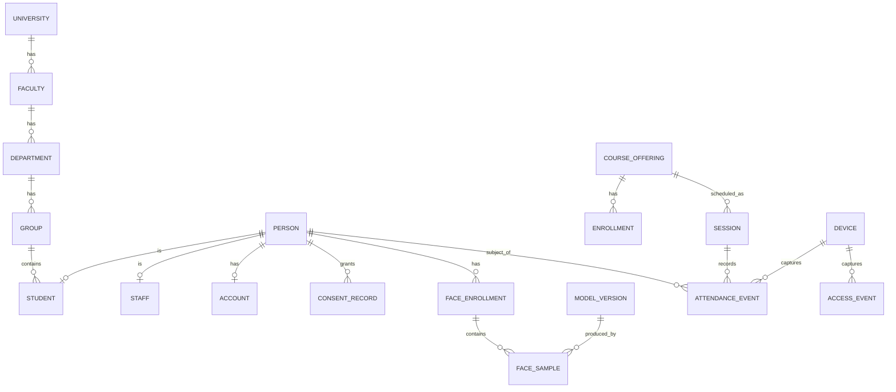

# Data model (draft)

**Status:** draft — entities and relationships only. No SQL, no ORM schema yet.
The persistence technology is still open (see `architecture.md` §7).

---

## Entities

### Organisation
| Entity | Key fields | Notes |
| --- | --- | --- |
| `University` | id, name, timezone, settings | Multi-tenant ready, single-tenant for v1 |
| `Faculty` | id, university_id, name | |
| `Department` | id, faculty_id, name | |
| `Group` | id, department_id, name, academic_year | Student cohort |
| `Course` | id, department_id, title, code | |
| `CourseOffering` | id, course_id, term, teacher_id | A course taught in a term |
| `Enrollment` | id, student_id, course_offering_id | Many-to-many student↔offering |

### People
| Entity | Key fields | Notes |
| --- | --- | --- |
| `Person` | id, university_id, full_name, external_id, status | Base identity, not a login |
| `Student` | person_id, group_id, student_number | |
| `Staff` | person_id, department_id, position | Teachers and admins share this |
| `Account` | id, person_id, email, password_hash, is_active | Authentication only |
| `Role` / `RoleAssignment` | account_id, role, scope | RBAC, scope = university/faculty/group |

Splitting `Person` from `Account` matters: a person can exist (be enrolled, be marked
present) before or without ever logging in.

### Biometrics — the sensitive part
| Entity | Key fields | Notes |
| --- | --- | --- |
| `ConsentRecord` | id, person_id, purpose, granted_at, revoked_at, document_ref | **Required** before any enrolment |
| `FaceEnrollment` | id, person_id, status, created_at, revoked_at | A person may have several; only one active |
| `FaceSample` | id, enrollment_id, embedding (vector), model_version, quality_score, crop_ref, created_at | The matching artefact |
| `ModelVersion` | id, name, dimension, provider, activated_at, retired_at | Embeddings are only comparable within one model version |

Rules:
- `FaceSample.embedding` dimension is fixed per `ModelVersion`. Never compare across versions.
- `crop_ref` points to object storage with its own retention clock; it is not a public URL.
- Revoking `FaceEnrollment` must remove or invalidate all its samples and index entries.

### Devices
| Entity | Key fields | Notes |
| --- | --- | --- |
| `Device` | id, university_id, type, location, public_key, status | kiosk / turnstile / door |
| `DeviceSession` | id, device_id, started_at, expires_at | Device auth, not user auth |
| `Room` | id, building, name, capacity | |

### Events
| Entity | Key fields | Notes |
| --- | --- | --- |
| `Session` | id, course_offering_id, room_id, device_id, starts_at, ends_at, created_by | A class or an event |
| `AttendanceEvent` | id, session_id, person_id, device_id, occurred_at, decision, similarity, margin, model_version, frame_ref, corrected_by | Append-only |
| `AccessEvent` | id, device_id, person_id, occurred_at, direction, decision, similarity | Turnstile/door |
| `UnresolvedCapture` | id, device_id, occurred_at, frame_ref, reason, reviewed_by | `no_match` / `ambiguous` for review |
| `AuditLog` | id, actor_account_id, action, target_type, target_id, occurred_at, metadata | Every read of biometric data |

`decision` enum: `match` · `ambiguous` · `no_match` · `manual` · `corrected`.

Separating `AttendanceEvent` from `AccessEvent` keeps academic attendance and physical
access retention/deletion policies independent — they usually differ.

---

## Relationships (core)

---

## Indexes and constraints (intent, not final DDL)

- Unique: `(university_id, external_id)` on `Person`; `(student_id, course_offering_id)` on `Enrollment`; one active `FaceEnrollment` per person.
- HNSW/IVFFlat index on `FaceSample.embedding` filtered by active `model_version`.
- Partial index on `UnresolvedCapture.reviewed_by IS NULL` — the operator queue.
- Partition `AttendanceEvent` and `AccessEvent` by month.
- Foreign keys `ON DELETE RESTRICT` for `Person` referenced by events; biometric rows `ON DELETE CASCADE` from `FaceEnrollment`.

---

## Open questions for this model

1. Is `Person` scoped per university, or global with memberships? (affects multi-tenancy)
2. Do visitors/guests get a `Person` row, or a lighter `VisitorVisit` entity?
3. Does attendance need a per-session "present / late / absent" state machine, or is the raw event enough?
4. Are corrections append-only (new `corrected` event) or in-place updates? Append-only is proposed.
5. How long are `UnresolvedCapture.frame_ref` images retained before review is impossible?
